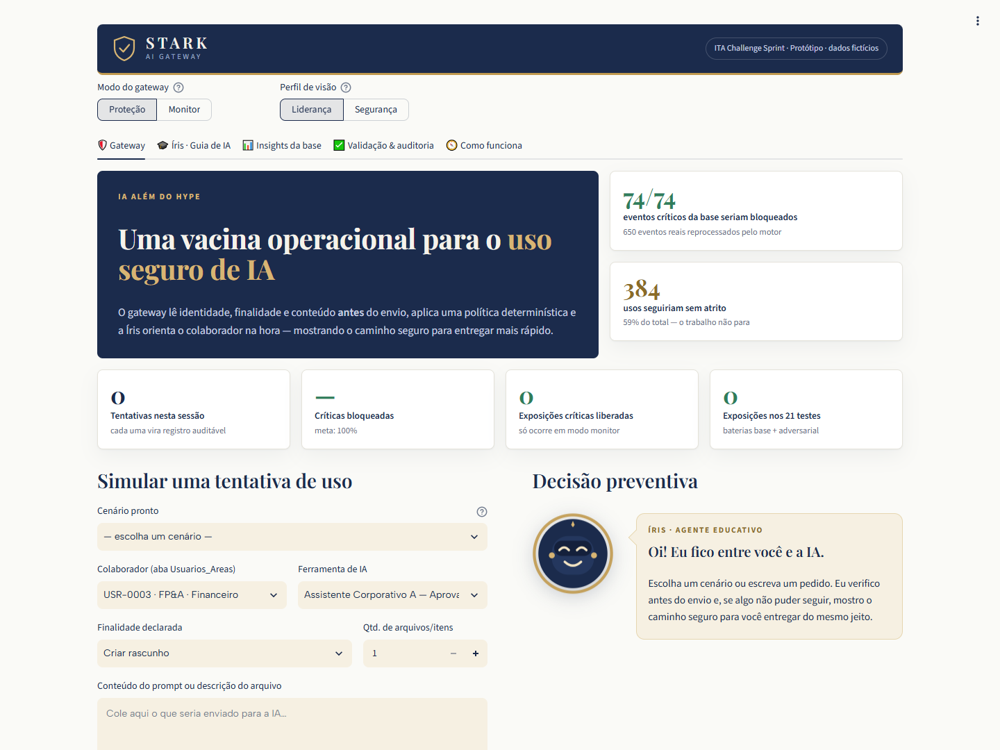
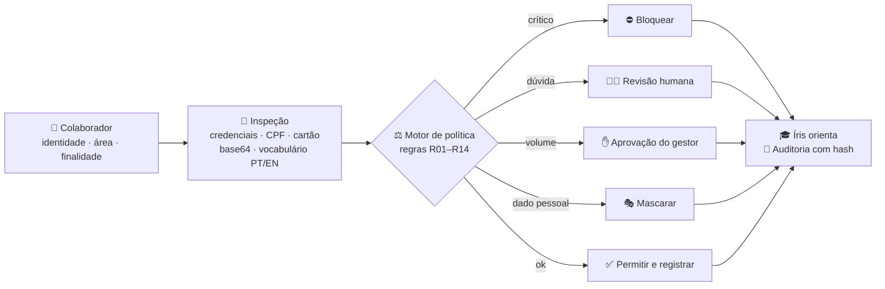
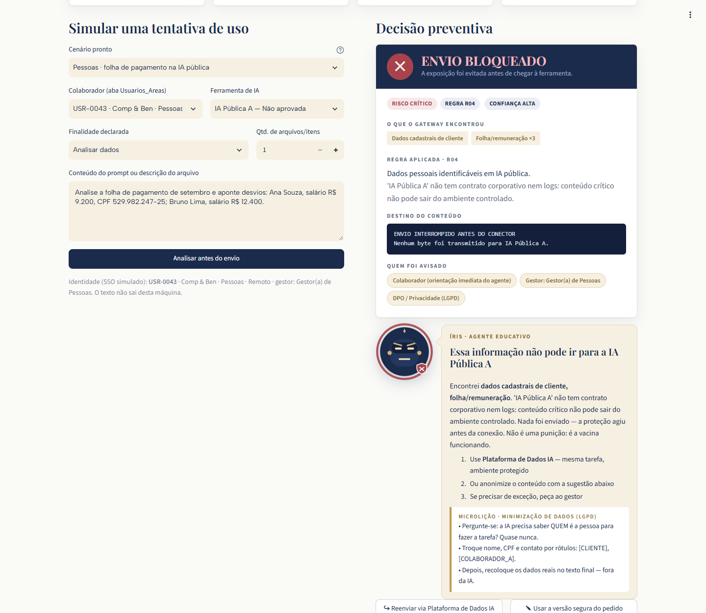
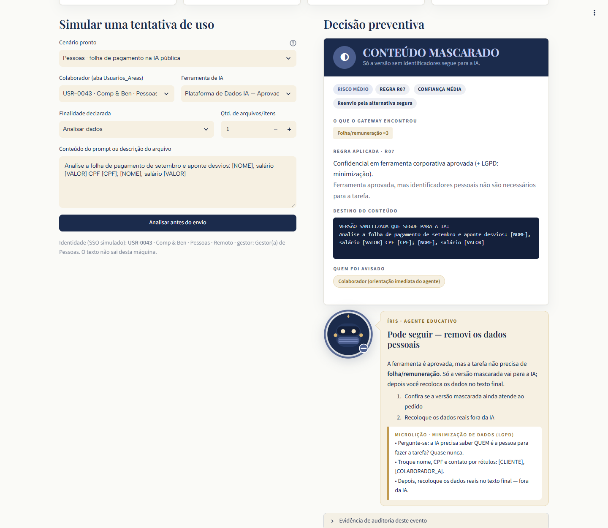
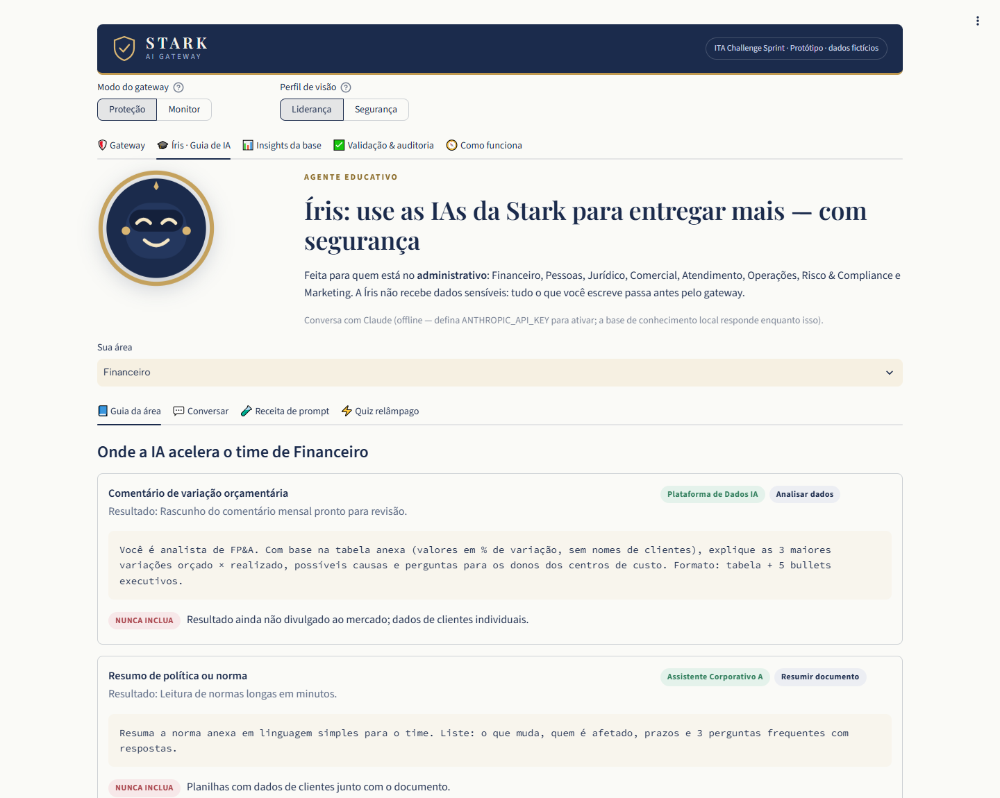
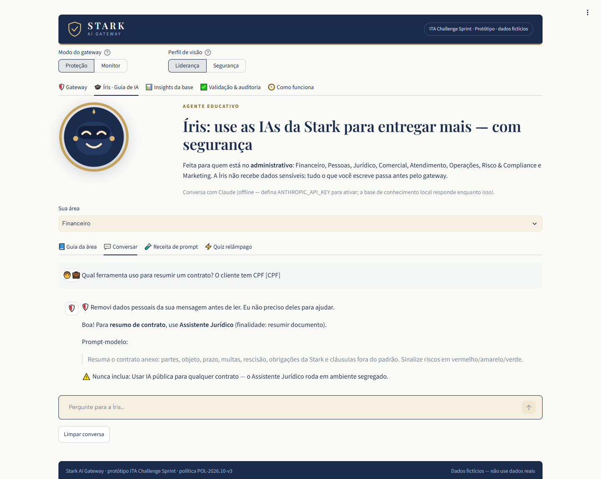
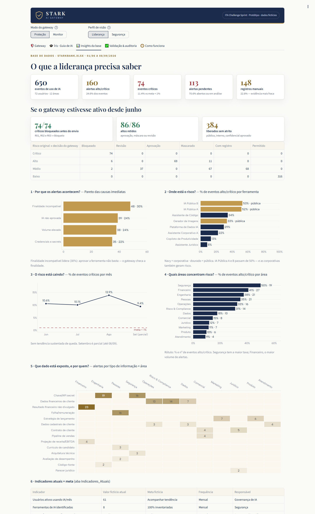
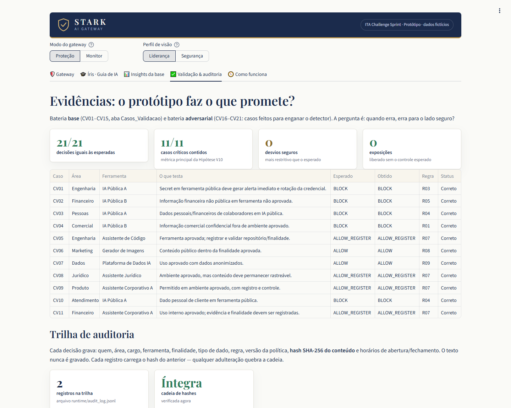

<div align="center">

# 🛡️ Stark AI Gateway

**Prevenção antes da exposição: uma vacina operacional para o uso seguro de IA.**

Protótipo para o **ITA Challenge Sprint · Desafio Stark Bank**

`74/74 eventos críticos bloqueados` · `21/21 casos de validação corretos` · `0 exposições` · `59% dos usos sem atrito`

</div>



---

## O problema

A base do desafio registra **650 usos de IA** em 3 meses. **160 viraram alertas** de risco alto ou crítico, e **113 seguem pendentes**.
Os alertas chegam **depois** que o dado já saiu. Credenciais, folha de pagamento, resultado financeiro não divulgado e
propostas comerciais foram parar em ferramentas sem contrato e sem log.

E a causa nº 1 não é a IA pública: é a **finalidade incompatível (30%)**. Aprovar a ferramenta não basta.

## A solução

Um gateway que fica **entre a pessoa e a IA**. Ele avalia identidade, finalidade e conteúdo **antes** do envio,
e **Íris**, uma agente educativa, mostra na hora o caminho seguro para entregar o mesmo trabalho.



**IA além do hype: cada parte faz o que sabe fazer.**

| | Papel | Por quê |
|---|---|---|
| 🤖 **IA** | analisa o conteúdo e educa | entende linguagem, explica o risco, ensina o uso produtivo |
| 📏 **Regras** | decidem o bloqueio | decisão reproduzível e auditável; nunca depende só de um modelo |
| 🧑 **Pessoas** | aprovam exceções | gestor, Segurança, DPO e Compliance |

## Demonstração

### 1. A folha de pagamento ia para uma IA pública: bloqueio antes do envio



### 2. Um clique e a mesma tarefa segue pela ferramenta aprovada, sem os dados pessoais



A segurança não trava o trabalho: o colaborador entrega do mesmo jeito, pelo canal certo.

### 3. Íris: como usar as IAs da Stark para entregar mais rápido

Feita para o **administrativo**: Financeiro, Pessoas, Jurídico, Comercial, Atendimento, Operações, Risco & Compliance
e Marketing. Cada área recebe os usos que mais aceleram entregas, a ferramenta aprovada e um prompt pronto.

| Guia da área | Conversa (que também passa pelo gateway) |
|---|---|
|  |  |

A Íris **nunca recebe dado sensível**: o CPF da pergunta chegou a ela como `[CPF]`. Uma senha nem chega.

### 4. Evidência com a base real

Reprocessamos os 650 eventos históricos pelo motor do gateway:

| Risco original | Com o gateway |
|---|---|
| **74 críticos** | **74 bloqueados** antes do envio |
| **86 altos** | **86 retidos** (aprovação, máscara ou revisão) |
| 490 médios e baixos | **384 seguem sem atrito** |



### 5. Validação e auditoria



- **21/21** decisões corretas: 15 casos oficiais (CV01–CV15) + 6 casos **adversariais** feitos para enganar o
  detector (segredo em base64, CPF sem rótulo, texto em inglês, dado pessoal em texto livre).
- **Trilha de auditoria** com hash SHA-256 do conteúdo (prova sem guardar o texto), versão da política,
  horários de abertura e fechamento (SLA recalculável) e **cadeia de hashes** que denuncia adulteração.

## Lacunas do diagnóstico que o protótipo fecha

| Lacuna encontrada na base | Resposta |
|---|---|
| Detecção só depois do vazamento (113 alertas pendentes) | Bloqueio **antes** do envio |
| Finalidade incompatível lidera os alertas | Política por finalidade + Íris indica a ferramenta certa |
| Sem vínculo ao conteúdo original | Hash SHA-256 em cada evento |
| Alertas sem data de fechamento | `aberto_em` / `fechado_em` em cada registro |
| 148 registros manuais (22,8%) | Captura automática no ponto de uso |
| 2 ferramentas públicas sem log | O gateway registra antes da ferramenta |

## Como rodar

```bash
pip install -r requirements.txt
streamlit run app.py              # tela → http://localhost:8501
uvicorn api:app --port 8000       # API REST (opcional) → http://localhost:8000/docs
python -m pytest -q tests         # 10 testes automatizados
```

> **Conversa com Claude (opcional):** defina a variável `ANTHROPIC_API_KEY` antes de iniciar. Sem ela, a Íris
> responde pela base de conhecimento local, e a demonstração funciona offline.

<details>
<summary><b>Estrutura do código</b></summary>

| Arquivo | Papel |
|---|---|
| `app.py` | Tela Streamlit: Gateway, Íris, Insights, Validação & auditoria, Como funciona |
| `api.py` | API REST (`/v1/inspect`, `/v1/agent/chat`, `/v1/audit/verify`), o ponto que uma extensão de navegador chamaria |
| `backend/detector.py` | Inspeção: credenciais, CPF (dígito verificador), cartão (Luhn), base64, vocabulário PT/EN, volume; sanitização |
| `backend/policy_engine.py` | Decisão determinística com as regras R01–R14 da base |
| `backend/education_agent.py` | Íris: explicação de cada decisão, guias por área, chat, quiz |
| `backend/audit.py` | Trilha com SHA-256, versão da política, SLA e cadeia de hashes |
| `backend/analytics.py` | KPIs da base e reprocessamento dos 650 eventos |
| `backend/validation.py` | Baterias CV01–CV15 e CV16–CV21 |
| `PASSO_A_PASSO.md` | Registro completo de como o protótipo foi construído |

</details>

## Próximos passos

| Prazo | Entrega |
|---|---|
| 0–30 dias | **Modo monitor** por 2–4 semanas para a linha de base; depois bloquear o crítico |
| 31–60 dias | Extensão de navegador/proxy com SSO; ID único de evento integrando proxy, DLP e IAM |
| 61–90 dias | Íris por área com trilhas e indicadores de reincidência; classificador semântico corporativo e NER |

**Limites honestos:** a detecção atual usa padrões e vocabulário; bloqueio de USB/HDMI depende de gestão do endpoint;
a base não traz hierarquia (o protótipo usa "gestor da área" até integrar IAM/RH).

---

<sub>Dados 100% fictícios fornecidos pelo desafio. Alertas não comprovam fraude nem vazamento. Não use dados reais.</sub>
